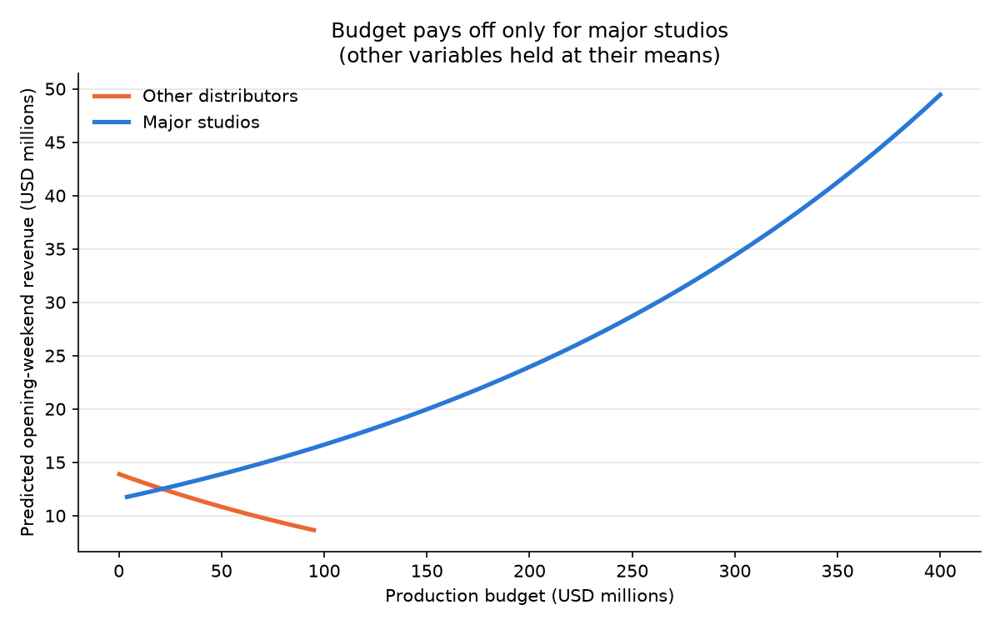
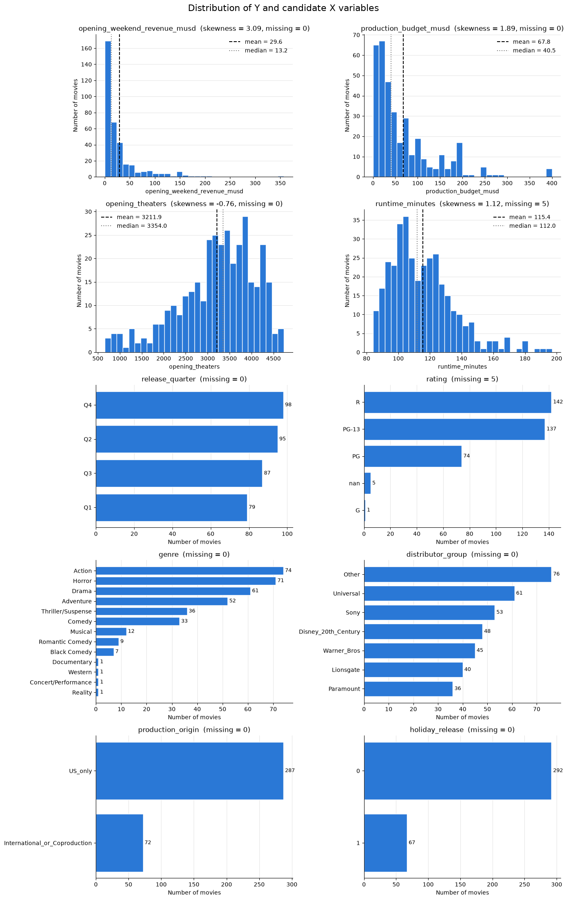
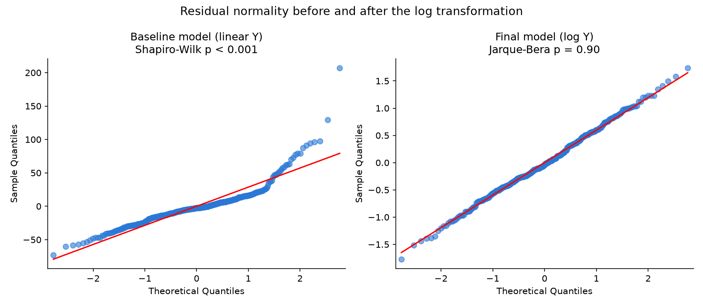
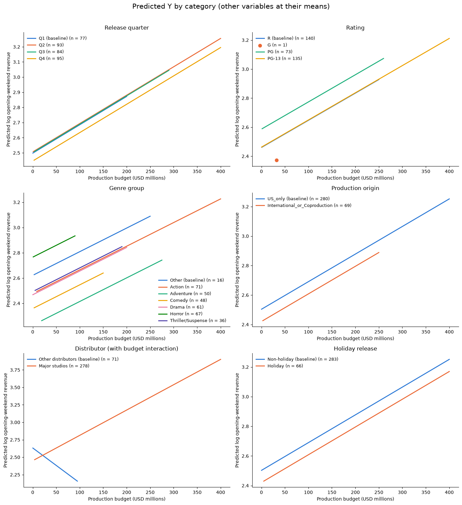

# What Drives a Movie's Opening Weekend? A Regression Analysis of 359 Wide Releases

Predicting domestic opening-weekend box office for U.S. wide releases (2019, 2022–2025) with multiple linear regression. The final model explains **76%** of the variation in log revenue, up from **53%** for a baseline model.

**Tools:** Python · pandas · NumPy · statsmodels · SciPy · matplotlib · ISLP · Jupyter

---

## Key findings

- **Distribution matters most.** Opening theater count is by far the strongest predictor (t = 16.5). Every 100 extra theaters is associated with about **10% higher** opening revenue, holding everything else constant.
- **A bigger budget only pays off for major studios.** For Disney, Warner Bros., Universal, Paramount, Sony and Lionsgate, each extra \$1M of budget is associated with about **+0.36%** opening revenue, or roughly +43% per extra \$100M. For smaller distributors the budget effect is slightly negative and not significant. The budget × major-studio interaction is significant (p = 0.018).
- **Genre has little effect once screens are known.** Adventure films open about **33% lower** than the "Other" genre group (p = 0.041). No other genre differs significantly.
- **Release timing and rating don't add predictive power.** Release quarter, holiday release, MPAA rating and international co-production all have no significant effect once theaters, budget and studio are controlled for.
- **Logging revenue fixed the model's statistical problems.** The baseline model's residuals were strongly non-normal (Shapiro-Wilk p < 0.001) and heteroskedastic (White p ≈ 10⁻²³). Modeling log revenue made the residuals close to normal (Jarque-Bera p = 0.90).
- **The model misses franchise hype.** On the training data, the median absolute percentage error is 39%. The largest misses are IP blockbusters, which the model underpredicts (*Deadpool & Wolverine* by \$143M, *The Super Mario Bros. Movie* by \$108M), and expensive films that disappointed, which it overpredicts (*Mission: Impossible – Dead Reckoning* by \$73M).

<p align="center">
  
</p>

---

## Business question and data

**Question:** Using only information available *before* release, how well can we predict a film's domestic opening-weekend revenue, and which levers matter?

| | |
|---|---|
| **Sample** | 359 domestic wide releases from 2019 and 2022–2025 |
| **Outcome (Y)** | `opening_weekend_revenue_musd`, the opening-weekend box office in USD millions |
| **Candidate predictors** | Production budget, opening theaters, runtime, release quarter, MPAA rating, genre, distributor, production origin, holiday release |
| **Sources** | The Numbers (release schedules and movie pages) and Lock5Data *HollywoodMovies*, compiled for McGill MGSC 661 |

Post-release variables such as audience score and total box office (about 44% missing) were deliberately excluded, because they would leak future information into an opening-weekend forecast.

---

## Approach

```
EDA → Baseline OLS → Assumption diagnostics → Transformations & feature design → Final OLS → Error analysis
```

### 1. Exploratory data analysis
- Built missing-value reports and descriptive statistics, and plotted the distribution of every candidate variable.
- Found that revenue is heavily right-skewed (skewness 3.09; mean \$29.6M vs. median \$13.2M), and that some categories are very sparse (four genres and the G rating each have only one film).

<p align="center">
  
</p>

### 2. Baseline model and diagnostics
Baseline: OLS of revenue on budget, theaters and runtime (R² = 0.526). Each regression assumption was tested:

| Assumption | Test | Result |
|---|---|---|
| Linearity | Residual-vs-fitted plot | Funnel shape; large positive residuals for big films |
| Independence | Durbin-Watson (release-date order) | 1.95, no autocorrelation |
| Constant variance | White's test | p ≈ 1.4 × 10⁻²³, heteroskedastic |
| Normality | Q-Q plot, Shapiro-Wilk | W = 0.86, p < 0.001, non-normal |
| Influence | Leverage (2p/n, 3p/n), Cook's distance | 31 influential films; *Avengers: Endgame* has Cook's D > 1 |

### 3. Transformations and feature design
| Variable | Treatment | Why |
|---|---|---|
| Revenue (Y) | Natural log | Skewness 3.09 → ≈ 0; stabilizes variance; coefficients read as % effects |
| Opening theaters | Kept linear | Correlates more strongly with log(Y) raw (0.83) than logged (0.76) |
| Genre | Grouped into 7 levels (`genre_group`) | Removes single-film categories |
| Distributor | Collapsed to a `major_studio` dummy | Tests the "big-studio" hypothesis with one clean contrast |
| Budget × major studio | Interaction term | Major studios may convert budget into marketing and screens more efficiently |
| Categoricals | Dummies with explicit baselines (Q1, R, Other, US-only) | Interpretable intercept shifts |
| Missing values | 10 rows dropped (2.8%) | Missing runtime or rating; not reliably imputable |

### 4. Final model

$$
\log(\text{Revenue}) = \beta_0 + \beta_1\,\text{Budget} + \beta_2\,\text{Theaters} + \beta_3\,\text{Runtime} + \text{Quarter} + \text{Rating} + \text{Genre} + \lambda\,\text{MajorStudio} + \text{Origin} + \text{Holiday} + \phi\,(\text{Budget} \times \text{MajorStudio}) + \varepsilon
$$

| Metric | Baseline | Final |
|---|---|---|
| Outcome | Revenue (\$M) | log(Revenue) |
| Predictors | 3 | 19 |
| R² | 0.526 | **0.758** |
| Adjusted R² | 0.522 | **0.744** |
| Residual normality | Rejected (p < 0.001) | Not rejected (JB p = 0.90) |

<p align="center">
  
</p>

Each panel below holds every other variable at its mean and draws one line per category. The vertical gaps between lines are the category effects.

<p align="center">
  
</p>

### 5. Error analysis and limitations
- **Accuracy:** MAE \$12.8M, RMSE \$24.4M, median absolute percentage error 39%.
- **Errors scale with film size:** MAE is \$2.2M in the lowest quartile of predicted revenue and \$33.4M in the highest.
- **Omitted variables:** there are no franchise, IP, star-power or marketing-spend features, which explains the largest blockbuster misses.
- **Retransformation bias:** converting log predictions back to dollars understates the average (\$24.7M predicted vs. \$30.0M actual).
- **No year effects:** 2022 releases are systematically overpredicted, consistent with the post-COVID recovery.
- **Multicollinearity:** budget and its interaction have VIFs of about 66–69, so their individual coefficients are imprecise.

**Next steps:** add franchise/sequel and year fixed effects, apply a smearing correction for dollar predictions, and validate on a hold-out set.

---

## Repository structure

```
├── movie_opening_regression.ipynb   # Full analysis: EDA → models → diagnostics → interpretation
├── movie_training_data_student.xlsx        # Dataset (README, Training_Data, Data_Dictionary sheets)
├── images/                                 # Figures used in this README
├── requirements.txt
└── README.md
```

## How to run

```bash
git clone https://github.com/xiaogouyy/ass1.git
cd ass1
pip install -r requirements.txt
jupyter notebook movie_opening_regression.ipynb
```

Run all cells from top to bottom. Tested with Python 3.13.
